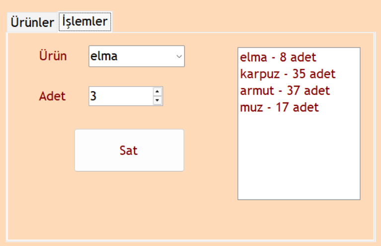

# 📦 Inventory & Sales Tracking System

A **C# Windows Forms** desktop application that enables users to register products with stock and pricing details, view real-time inventory analytics, and dynamically update stock levels through sales transactions.

---

## 🖥️ Application Screenshots

### 1. Products Tab (Product Entry & Analytics)
Users input the product name, stock quantity, and unit price to add items to the system[cite: 3]. The information panel on the right dynamically calculates and displays the total product count, average price, cheapest/most expensive items, and products with the lowest/highest stock levels[cite: 3].

  

### 2. Transactions Tab (Sales & Live Stock Tracking)
Users select a registered product from the dropdown list, specify the sales quantity, and click **Sell** (`Sat`)[cite: 2]. The sold quantity is deducted from the inventory, and the updated stock list on the right refreshes instantaneously[cite: 2].

  

---

## ✨ Features

* **Product & Inventory Management:** Dynamic record creation via product name, stock quantity, and unit price inputs[cite: 3].
* **Real-Time Inventory Analytics:** Automated calculations across all registered items for:
  * Total number of product varieties[cite: 3],
  * Average product price[cite: 3],
  * Cheapest and most expensive products[cite: 3],
  * Products with the lowest and highest stock counts[cite: 3].
* **Dynamic Sales & Stock Deduction:** Automated stock reduction based on selected product and quantity, synchronized with the live stock list[cite: 2].

---

## 🛠️ Tech Stack

* **Language:** C#
* **UI Framework:** Windows Forms (WinForms)
* **IDE:** Visual Studio
