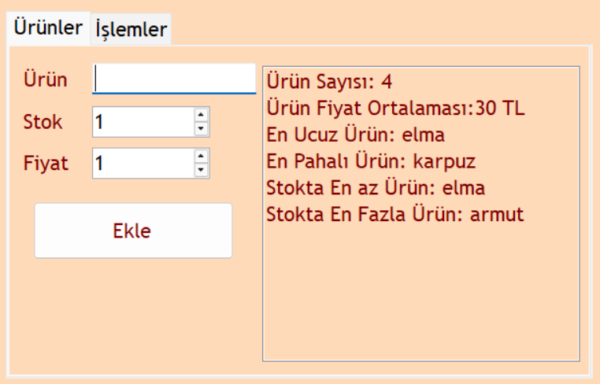

# 📦 Stok ve Satış Takip Uygulaması

Kullanıcıların sisteme ürün, stok ve fiyat bilgisi ekleyebildiği, anlık stok analizlerini görüntüleyebildiği ve satış işlemleriyle stokları dinamik olarak güncelleyebildiği **C# Windows Forms** masaüstü uygulamasıdır.

---

## 🖥️ Uygulama Görselleri

### 1. Ürünler Sekmesi (Ürün Ekleme & İstatistikler)
Kullanıcı ürün adı, stok adedi ve birim fiyat bilgilerini girerek sisteme yeni ürün ekler. Sağ taraftaki bilgi panelinde toplam ürün sayısı, ortalama ürün fiyatı, en ucuz/en pahalı ürünler ve stok durumu en az/en fazla olan ürünler anlık olarak hesaplanıp listelenir.

  

### 2. İşlemler Sekmesi (Satış & Güncel Stok Takibi)
Kullanıcı açılır listeden mevcut bir ürünü seçip satış adedini belirleyerek **Sat** butonuna tıkladığında, satılan miktar mevcut stoktan düşülür ve sağ taraftaki listede tüm ürünlerin güncel stok durumu anında yenilenir.

  

---

## ✨ Özellikler

* **Ürün ve Envanter Yönetimi:** Ürün adı, stok miktarı ve fiyat girişi ile dinamik kayıt oluşturma.
* **Anlık Envanter Analizi:** Eklenen ürünler üzerinden otomatik olarak;
  * Toplam ürün çeşidi sayısını,
  * Ürünlerin ortalama fiyatını,
  * En ucuz ve en pahalı ürünleri,
  * Stok adedi en az ve en fazla olan ürünleri hesaplama.
* **Dinamik Satış ve Stok Düşümü:** Seçilen ürün ve satış adedine göre stok güncellemesi ve güncel stok listesinin eşzamanlı yenilenmesi.

---

## 🛠️ Kullanılan Teknolojiler

* **Dil:** C#
* **Arayüz:** Windows Forms (WinForms)
* **Geliştirme Ortamı:** Visual Studio
